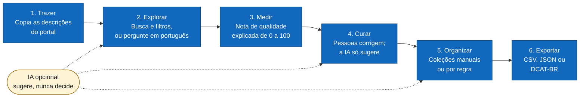

# Como o sistema funciona

**Em palavras simples:** o Inspire Catálogo é uma **cópia pesquisável** do catálogo de dados abertos do governo
(dados.gov.br), com ferramentas para **medir** e **melhorar** a qualidade da descrição de cada conjunto de dados.
Ele guarda só as **descrições** (os "metadados"), nunca os arquivos de dados. Não altera nada no portal. Uma
inteligência artificial pode **sugerir** melhorias, mas só vale o que uma pessoa aprovar.

*Esta página é para todo mundo: produto, pesquisa, testadores e engenharia. Para ver o sistema por dentro, siga a
ordem: [C1 Contexto](c1-contexto.md) → [C2 Contêineres](c2-conteineres.md) → [C3 Componentes](c3-componentes.md) →
[Fluxos](fluxos.md).*

## Para que serve, para cada pessoa
| Quem | O que faz no sistema |
|---|---|
| **Explorador(a) de dados** | Procura conjuntos por assunto, por órgão ou por pergunta em português; vê a nota de qualidade e o link para o portal; exporta uma lista para planilha. |
| **Curador(a)** | Corrige título, descrição e palavras-chave; aprova ou rejeita sugestões da IA; organiza coleções (por exemplo, "bases sociais"). |
| **Coordenação** | Acompanha a qualidade geral e por órgão, o andamento da curadoria e a data da última atualização. |

## A jornada em seis passos

## O que cada tela faz
| Tela | Para que serve |
|---|---|
| **Painel** | Números gerais: total de conjuntos, qualidade, andamento da curadoria, última atualização. |
| **Buscar** | Busca por palavras (aceita erro de acento e de digitação), filtros por órgão, tema, formato e nota. |
| **Perguntar** | Você escreve o que procura em português; o sistema mostra como entendeu e traz os conjuntos. |
| **Detalhe do conjunto** | Todas as informações, a nota explicada, o histórico, e o formulário para corrigir os metadados. |
| **Fila de curadoria** | Os conjuntos que mais precisam de atenção, para revisar um a um ou em lote. |
| **Coleções** | Grupos de conjuntos. Manual (você escolhe) ou dinâmica (uma regra; se atualiza sozinha). Dá para descrevê-la em texto. |
| **Organizações** | Os órgãos que publicam, com qualidade média e o que mais precisa melhorar. |
| **Sugestões de LLM** | Pede sugestões de palavras-chave, descrição ou tema para vários conjuntos e revisa uma a uma. |
| **Extração** | Atualiza a cópia com as mudanças do portal e mostra o histórico. |
| **Configurações** | Quanto vale cada regra da nota de qualidade. |

## Onde a inteligência artificial entra (e onde não)
- **Sugere, nunca decide.** Cada sugestão aparece ao lado do valor atual e só entra no catálogo se uma pessoa aprovar.
- **Só vê informação pública.** Título, descrição, palavras-chave, temas, órgão, formatos, licença e periodicidade.
  Nunca contatos de pessoas, nunca a base curada inteira.
- **Dois modos.** *Simulado* (padrão: regras simples, sem IA e sem internet; serve para treinar) e *real* (usa um
  serviço de LLM gratuito escolhido por configuração; a tela avisa que há um provedor externo).
- **No chat e na coleção por texto**, a IA só traduz o seu pedido em filtros; quem busca é o próprio catálogo.

## Para onde vão os dados
| Dado | Onde fica | Sai do computador? |
|---|---|---|
| Descrições dos conjuntos (cópia do portal) | Banco de dados do sistema | Não |
| Suas correções, coleções e decisões | Mesmo banco | Não |
| Contatos de responsáveis (nome, e-mail) | **Não são guardados**: são removidos na extração | Não existem no sistema |
| Texto que você digita em "Perguntar" ou na coleção por texto | Não é guardado | **Só se houver LLM real configurado**: vai ao provedor escolhido |
| Campos públicos de um conjunto, ao pedir sugestões | Nada | **Só com LLM real**: vai ao provedor escolhido |
| Os arquivos de dados dos conjuntos | **Nunca são baixados**: só o link | Não |

## O que o sistema não faz (por enquanto)
Não baixa nem analisa os arquivos dos conjuntos; não verifica se os links funcionam; não altera o portal; não tem login
nem vários usuários; não atualiza sozinho (a atualização é por botão); não busca por significado (só por palavras);
não responde perguntas analíticas ("qual órgão publica mais?").

## Glossário
| Termo | Significado |
|---|---|
| **Metadados** | A descrição de um conjunto: título, descrição, órgão, licença, temas, formatos. Não são os dados em si. |
| **Conjunto de dados / recurso** | O conjunto é o "item" do catálogo; os recursos são os arquivos ou APIs que ele oferece (o sistema guarda o link). |
| **Extração** | Trazer (ou atualizar) a cópia das descrições do portal. A atualização só traz o que mudou. |
| **Curadoria** | Revisar e melhorar as descrições. O dado original do portal nunca é alterado: a correção fica ao lado, com histórico. |
| **Nota de qualidade** | De 0 a 100, calculada por regras claras (descrição completa, licença informada, formato aberto...). Cada ponto é explicado. |
| **Coleção** | Um grupo de conjuntos. *Dinâmica* quer dizer que é definida por uma regra e se atualiza a cada extração. |
| **DCAT-BR** | O padrão do governo brasileiro para descrever catálogos de dados. O sistema exporta nesse formato. |
| **LLM** | O tipo de inteligência artificial que escreve texto (como os assistentes de chat). Aqui, só sugere. |
| **Modo simulado** | O LLM "de mentira": regras simples, sem IA e sem enviar nada a ninguém. |
