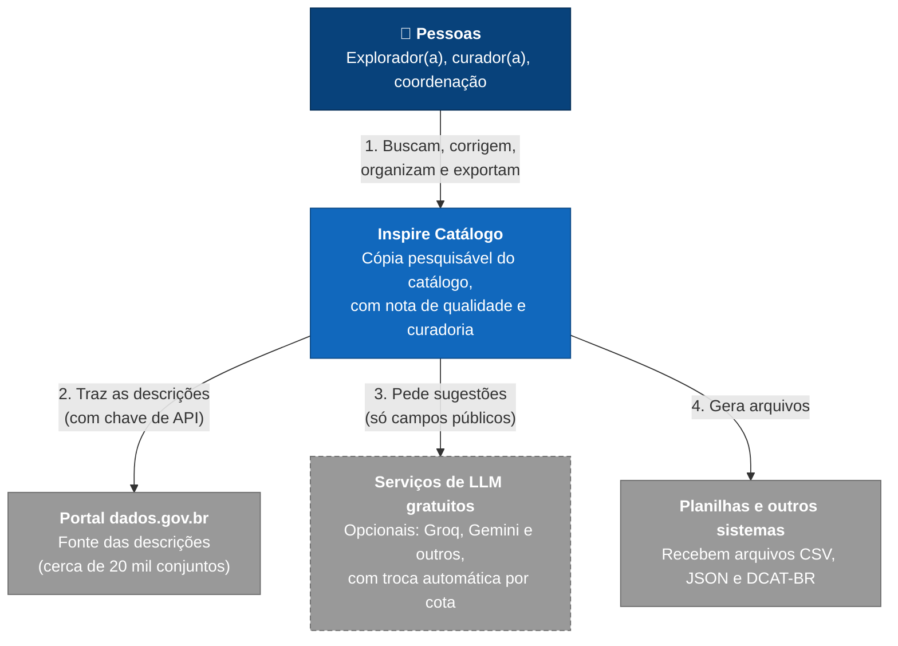

# C4 — Nível 1: Contexto

**Em palavras simples:** quem usa o sistema e com quais serviços de fora ele conversa. Três tipos de pessoa usam a tela;
o sistema busca as descrições no portal dados.gov.br e, se ligado, pede ajuda a um serviço de inteligência artificial.
Os resultados saem em arquivos que podem ir para planilhas ou outros sistemas.

*Leia primeiro [Como o sistema funciona](00-como-o-sistema-funciona.md). Aqui aparece só o que está fora do sistema.*

*Tracejado = opcional.*

## Legenda das setas
| # | O que acontece | Observações |
|---|---|---|
| 1 | As pessoas usam o sistema pelo navegador | Um usuário por vez; não há login |
| 2 | O sistema copia as descrições do portal | Exige a chave de API do portal; ritmo limitado (4 chamadas por segundo) para não ser bloqueado |
| 3 | O sistema pede sugestões a um LLM | Desligado ou simulado por padrão; só campos públicos; nunca contatos pessoais |
| 4 | O sistema entrega arquivos | O que sai é só o que o usuário pede (uma busca ou uma coleção) |

## Para engenharia
- **Portal:** API REST com cabeçalho `chave-api-dados-abertos`. É intermitente (listas vazias ocasionais) e responde
  HTTP 405 se chamado rápido demais; o cliente trata as duas coisas (ver [fluxos](fluxos.md), seção 1).
- **LLM:** qualquer serviço compatível com a API "chat completions". Há provedor simulado (padrão) e um roteador de
  provedores gratuitos ([ADR-0014](../03-decisoes/0014-roteador-de-provedores-llm.md)).
- **Segurança e soberania** ([ADR-0002](../03-decisoes/0002-seguranca-e-soberania.md)): o único sistema externo que
  recebe dados do projeto é o provedor de LLM, e só com campos públicos ([ADR-0004](../03-decisoes/0004-provedor-de-llm-externo-controlado.md)).
- **Fora de escopo agora (fase 2):** verificar links dos recursos nos servidores dos órgãos e propor alterações de volta ao
  portal. O modelo de dados já separa o espelho da curadoria para viabilizar isso depois.
