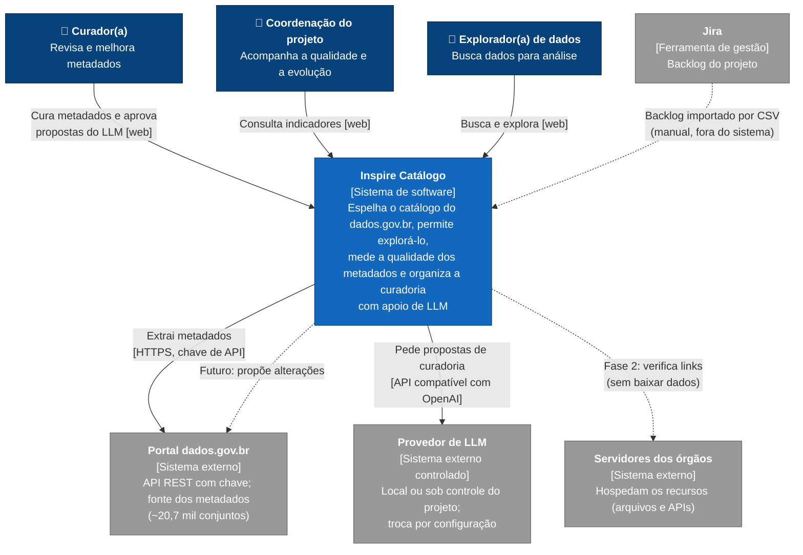

# C4 — Nível 1: Contexto do sistema

Mostra o Inspire Catálogo, quem o usa e com quais sistemas externos ele conversa. Não depende de
tecnologia. Linhas tracejadas são integrações previstas para depois do MVP.

## Notas
- O Jira não integra com o sistema em tempo de execução; aparece só para situar o backlog.
- A seta tracejada de volta ao portal exige perfil de administrador de organização e não está no
  curto nem no médio prazo; o modelo de dados já separa espelho e curadoria para viabilizá-la.
- Segurança e soberania ([ADR-0002](../03-decisoes/0002-seguranca-e-soberania.md)): o único sistema
  externo que recebe dados do projeto seria o provedor de LLM, e ele deve ser local ou controlado.
