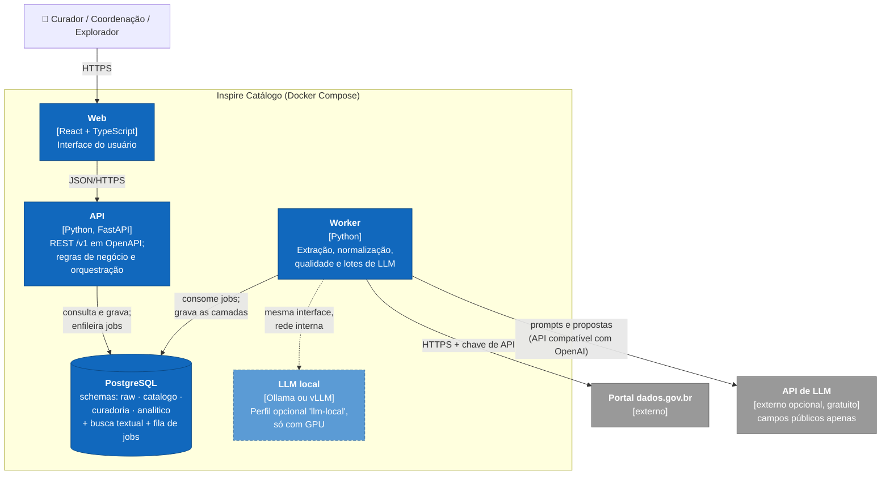

# C4 — Nível 2: Contêineres

**Em palavras simples:** o sistema é feito de cinco peças que rodam juntas: a tela que o usuário vê (Web), o
"cérebro" que atende pedidos (API), um trabalhador que faz as tarefas demoradas em segundo plano (Worker), o
banco de dados e, de forma opcional, um LLM rodando localmente. Fora dele ficam o portal de dados e,
opcionalmente, uma API de LLM.

Mostra as partes executáveis do Inspire Catálogo e como se comunicam. Reflete
[ADR-0003](../03-decisoes/0003-stack-tecnologica.md) (stack),
[ADR-0004](../03-decisoes/0004-provedor-de-llm-externo-controlado.md) (LLM) e
[ADR-0005](../03-decisoes/0005-armazenamento-em-camadas.md) (armazenamento).
Linhas tracejadas são opcionais ou futuras.

## Notas de desenho
- **Troca de LLM por configuração:** o worker fala com qualquer servidor compatível com a API da
  OpenAI, externo ou local. Habilitar GPU no futuro é ligar o perfil `llm-local` e apontar a
  configuração para ele; nenhum código de negócio muda (US-069).
- **Ponto único de entrada:** só o `web` fica exposto; `api`, `worker`, `db` e LLM local ficam em rede
  interna.
- **Snapshot só quando muda:** o JSON bruto é gravado em `raw` apenas se o hash mudou.
- **A API também consulta o LLM no futuro** (chat em linguagem natural, EP-09); por isso o contrato é
  compartilhado entre API e worker.
