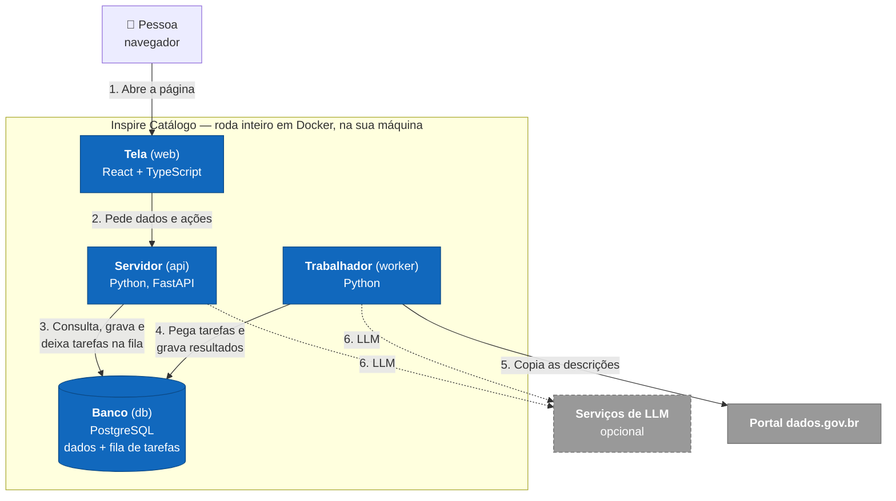

# C4 — Nível 2: Contêineres

**Em palavras simples:** o sistema é feito de quatro peças que rodam juntas num computador: a **tela** que a pessoa vê,
o **servidor** que atende os pedidos, um **trabalhador** que faz as tarefas demoradas em segundo plano (como copiar o
portal) e o **banco de dados** onde tudo fica guardado. Tudo sobe com um único comando.

## Legenda das setas
| # | O que acontece |
|---|---|
| 1 | A pessoa abre `http://127.0.0.1:8080`. É a única porta aberta do sistema. |
| 2 | A tela só conversa com o servidor, por uma API REST (`/api/v1`). Nunca fala com o banco nem com o LLM. |
| 3 | O servidor responde às consultas e, para o que demora (extração, lote de LLM), grava um pedido na fila dentro do banco. |
| 4 | O trabalhador fica olhando a fila, executa o pedido e grava o resultado. |
| 5 | Só o trabalhador fala com o portal (é ele que tem a chave de API do portal). |
| 6 | O LLM é chamado de dois jeitos. **Trabalhador:** sugestões de curadoria para vários conjuntos, uma por vez, em segundo plano. **Servidor:** só para traduzir um pedido digitado (Perguntar e coleção por texto), porque é rápido e a pessoa espera na tela. Tracejado = opcional. |

## Para engenharia
| Contêiner (serviço do compose) | Tecnologia | Responsabilidade | Rede |
|---|---|---|---|
| `web` | nginx servindo o build do React/TypeScript (Vite) | Interface; repassa `/api/` ao servidor (resolve o nome `api` dinamicamente) | **Única** porta publicada: `127.0.0.1:8080` |
| `api` | Python 3.12, FastAPI, SQLAlchemy | REST `/v1` em OpenAPI (`/api/docs`); regras de negócio; enfileira jobs | Interna; porta 8000 |
| `worker` | Mesma imagem do `api` | Laço que consome a fila (`SELECT … FOR UPDATE SKIP LOCKED`): extração, normalização, qualidade, lotes de LLM | Interna; sai para o portal e para o LLM |
| `db` | PostgreSQL 16 | Camadas `raw`, `catalogo`, `curadoria`, `analitico`; busca textual; a fila de jobs | Interna |
| `migrate` | Mesma imagem do `api` | Roda as migrações (Alembic) e termina | — |

- **Uma imagem para três serviços** (`inspire-backend:dev`): `api`, `worker` e `migrate` compartilham o código; muda só o comando.
- **Endurecimento:** contêineres sem root, sistema de arquivos somente leitura onde possível, capacidades removidas.
- **Segredos:** a chave do portal só vai ao `worker`; as chaves de LLM vão ao `api` e ao `worker` (o `api` valida o
  provedor ao criar a execução). Ficam no `.env`, que não é versionado.
- **Código:** `app/backend/src/inspire/` (api, worker, módulos) e `app/frontend/src/`.
- **Subir:** `docker compose up --build`. **Testar:** `bash scripts/qualidade.sh` e `bash scripts/e2e.sh`.
- **LLM local em GPU:** previsto (perfil `llm-local`, US-069), **não implementado**; o código já aceita qualquer
  servidor compatível, bastando apontar a configuração.
- Decisões: [ADR-0003](../03-decisoes/0003-stack-tecnologica.md) (stack), [ADR-0005](../03-decisoes/0005-armazenamento-em-camadas.md)
  (banco em camadas), [ADR-0007](../03-decisoes/0007-fila-de-jobs.md) (fila no banco).
