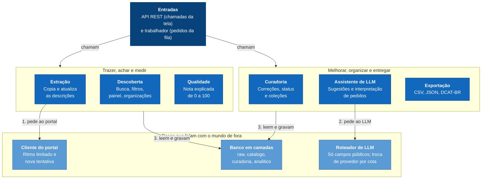

# C4 — Nível 3: Componentes do servidor

**Em palavras simples:** por dentro, o servidor é dividido em **módulos**, cada um com uma função: trazer dados do
portal, organizá-los, buscar, medir a qualidade, registrar a curadoria, conversar com o LLM e exportar. Cada módulo cuida
da sua parte e pede aos outros o que não é dele. Tudo o que fala com o mundo de fora (portal, banco, LLM) passa por uma
peça trocável; é isso que permite, por exemplo, trocar de LLM sem mexer no resto.

*O servidor (`api`) e o trabalhador (`worker`) usam o mesmo código. Muda só quem dispara: uma chamada da tela ou um
pedido da fila.*

## O que cada módulo faz
| Módulo | Função, em palavras simples | Pasta do código (`app/backend/src/inspire/`) | Quem o aciona |
|---|---|---|---|
| **Extração** | Copia as descrições do portal, tira os dados pessoais e transforma em tabelas; atualiza só o que mudou | `extraction/`, `worker/` | Botão "Atualizar catálogo" ou comando |
| **Descoberta** | Busca em português, filtros, painel, organizações, detalhe do conjunto | `discovery/`, `analytics/` | Telas Buscar, Painel, Organizações |
| **Qualidade** | Calcula a nota por regras e explica cada ponto | `quality/` | Depois de cada extração e ao editar os pesos |
| **Curadoria** | Guarda as correções ao lado do original, o status de revisão e as coleções | `curation/` | Telas Detalhe, Fila, Coleções |
| **Assistente de LLM** | Gera sugestões de curadoria; traduz pedidos em português em filtros; escolhe o provedor | `llm/` | Telas Sugestões de LLM, Perguntar, Coleções |
| **Exportação** | Gera CSV, JSON e DCAT-BR com qualidade em DQV | `export/` | Botões "Exportar" |
| *Entradas* | Rotas REST e laço do trabalhador | `api/`, `worker/` | Tela e fila |

## Regras de dependência (para quem altera o código)
- Cada módulo só usa as funções públicas dos outros; nenhum lê as tabelas de outro módulo por conta própria.
- **Só a Curadoria escreve no schema `curadoria`.** O Assistente de LLM apenas **propõe**; a aplicação da proposta passa
  pela Curadoria e só acontece com a aprovação de uma pessoa.
- **O LLM nunca recebe dados sem passar pela barreira de campos públicos** (testada: contatos pessoais não saem).
  O roteador de provedores fica atrás dessa barreira ([ADR-0014](../03-decisoes/0014-roteador-de-provedores-llm.md)).
- A tela usa apenas a API REST; não acessa o banco nem o LLM.
- O que depende de tecnologia concreta (Postgres, HTTP, provedor de LLM) fica nas peças de fora; trocar uma delas não
  exige mexer nos módulos.

## As telas (frontend)
| Tela | Módulos que usa |
|---|---|
| Painel, Buscar, Organizações, Detalhe | Descoberta, Qualidade, Curadoria |
| Perguntar | Assistente de LLM, Descoberta |
| Fila de curadoria, Coleções | Curadoria, Descoberta, Assistente de LLM (coleção por texto) |
| Sugestões de LLM | Assistente de LLM, Curadoria |
| Extração | Extração |
| Configurações | Qualidade |
