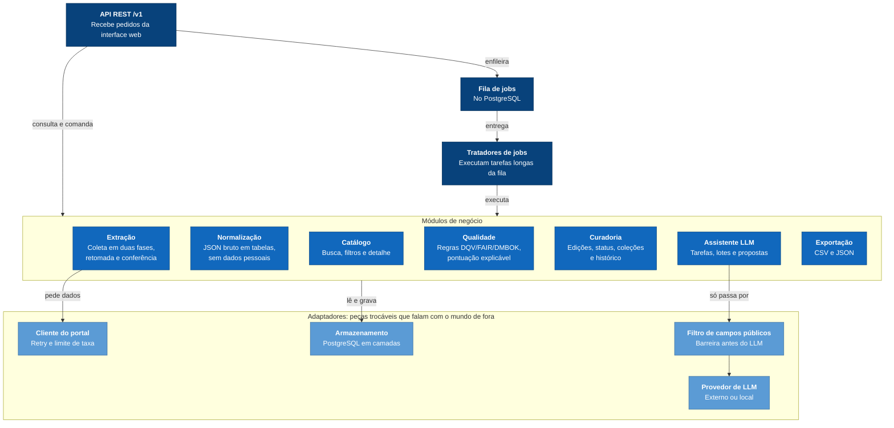

# C4 — Nível 3: Componentes do backend

**Em palavras simples:** por dentro, o sistema é dividido em módulos, cada um com uma função: buscar
dados no portal, organizá-los, medir a qualidade, registrar a curadoria e conversar com o LLM. Os
módulos não mexem nos dados uns dos outros diretamente: pedem uns aos outros. Tudo que fala com o
mundo de fora (portal, banco, LLM) passa por uma peça trocável chamada **adaptador**. É isso que
permite trocar o LLM ou, no futuro, escrever no portal sem reescrever o resto.

A API e o Worker usam o mesmo código; mudam apenas o que os dispara (uma chamada web ou um job da fila).

## Regras de dependência
- Módulos só se conhecem pelas interfaces públicas uns dos outros. Nenhum módulo lê as tabelas de outro.
- Dentro dos módulos: a Extração entrega ao Normalizador o que coletou; o Assistente LLM propõe por meio
  da Curadoria; a Exportação lê Catálogo e Curadoria. O diagrama omite essas setas internas de propósito.
- O **Assistente LLM** nunca fala com o provedor diretamente: tudo passa pelo **filtro de campos
  públicos**, que é testado para garantir que contatos pessoais não saem (US-068).
- O módulo **Curadoria** é o único que escreve no schema `curadoria`; o Assistente apenas **propõe**
  por meio dele, e só a aprovação humana aplica a alteração.

## Componentes do frontend (Web)
| Tela | Função | Épico |
|---|---|---|
| Painel | Indicadores gerais do catálogo e da última extração | EP-02 |
| Busca | Busca textual, filtros e lista de resultados | EP-02 |
| Detalhe do conjunto | Original x curado, qualidade, recursos, histórico | EP-02, EP-04 |
| Organizações | Lista e indicadores por órgão | EP-02 |
| Fila de curadoria | Conjuntos priorizados e propostas do LLM para revisão | EP-04, EP-05 |
| Coleções | Criar e gerenciar coleções (manuais e por filtros salvos) | EP-04 |
| Extração | Disparar, acompanhar progresso e ver histórico e relatório | EP-01 |
| Configurações | Regras de qualidade, tarefas de LLM e provedor ativo | EP-03, EP-05 |

O frontend usa apenas a API REST; não acessa o banco nem o LLM.
