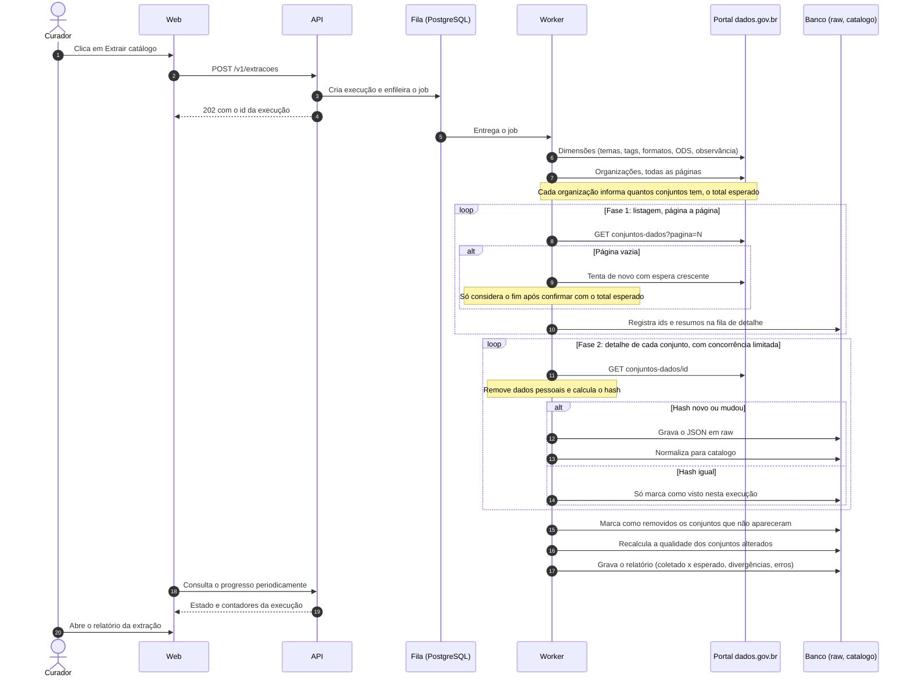
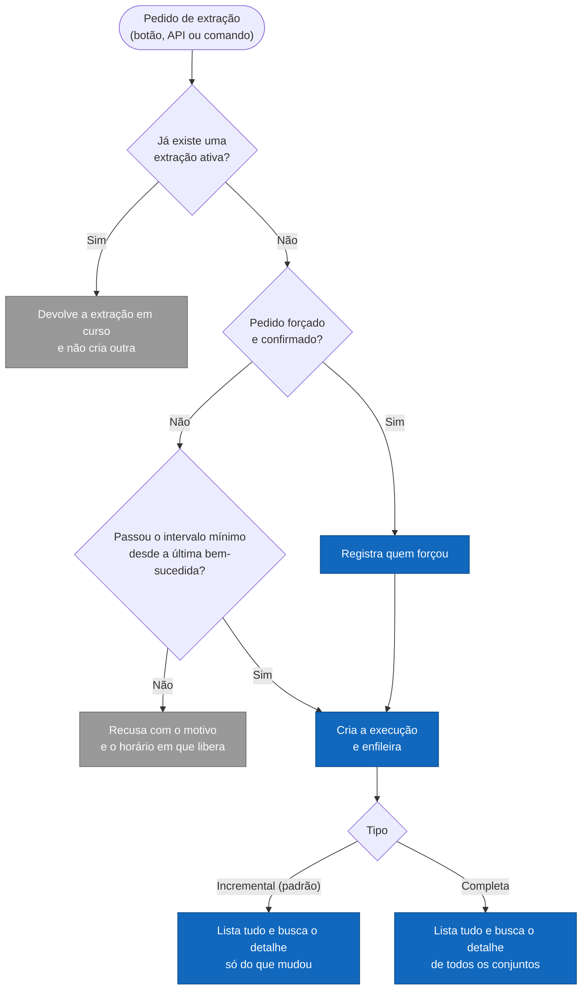
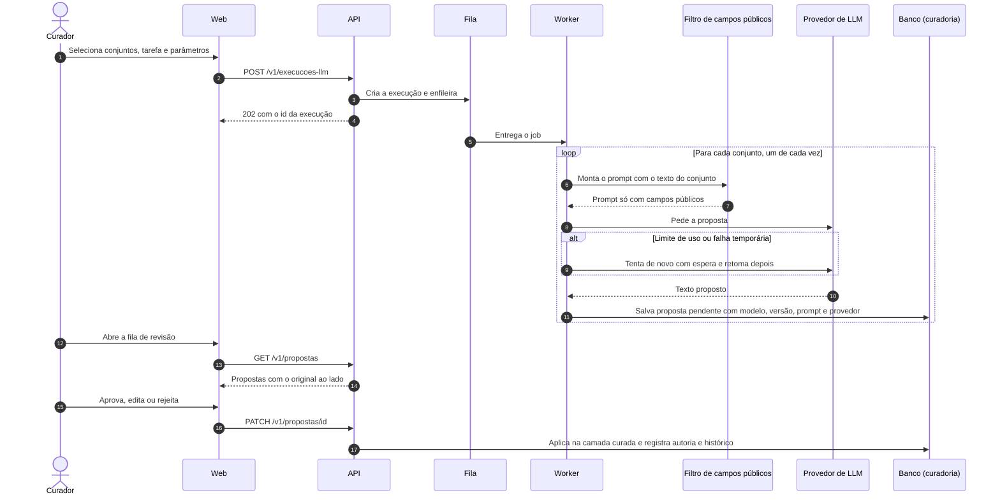
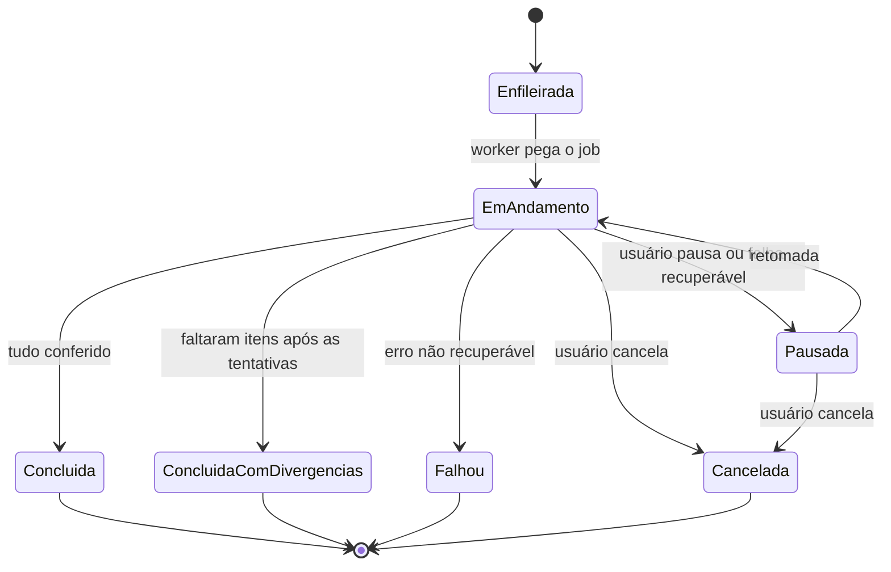
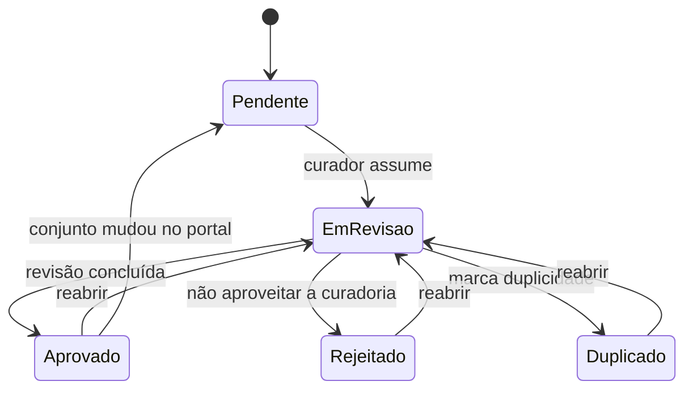
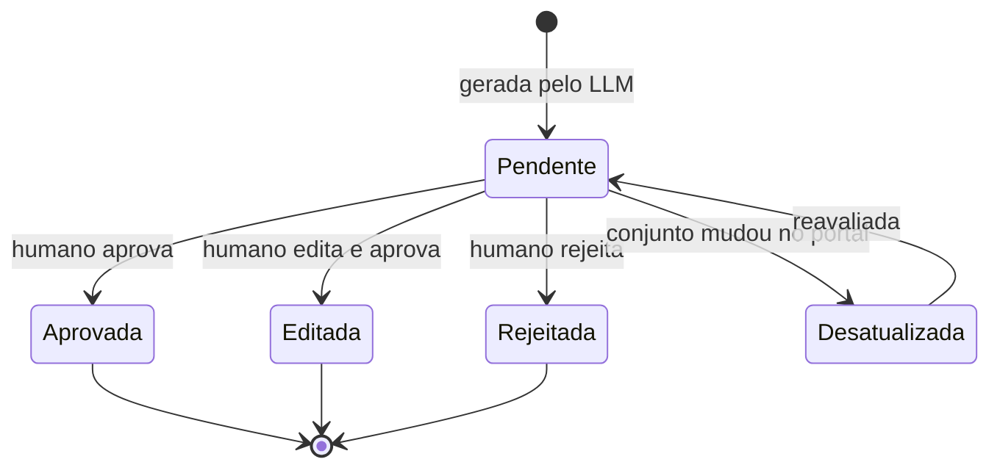
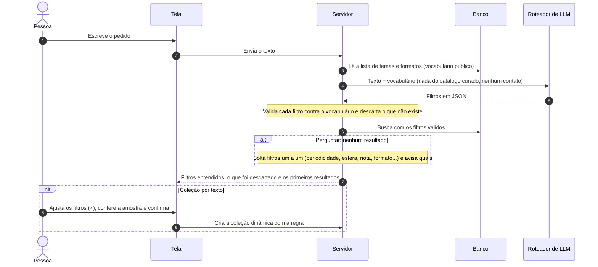
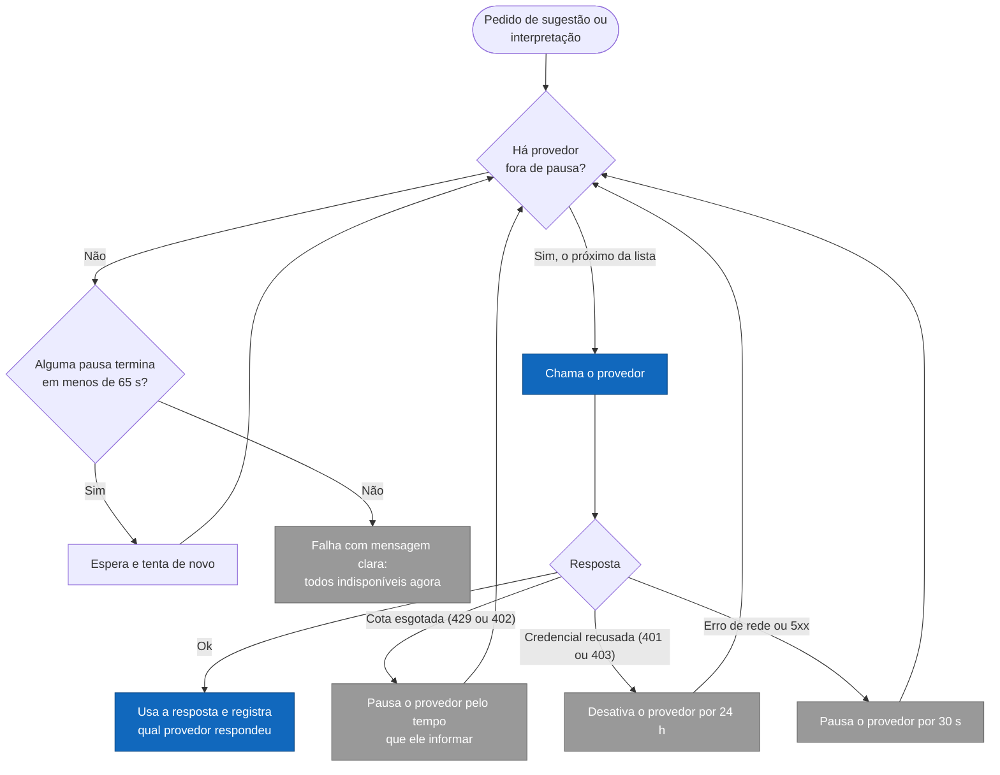

# C4 — Nível 4: Fluxos e estados

**Em palavras simples:** estes diagramas contam o que acontece, passo a passo, nas operações mais importantes
(trazer o catálogo do portal, curar com ajuda do LLM, perguntar em português e escolher qual LLM usar) e mostram por
quais situações passam as coisas que têm ciclo de vida (uma extração, um conjunto em curadoria, uma proposta do LLM).
Não há diagramas de classes, como combinado.

Mapa: **1** Extração · **2** Curadoria com LLM · **3** Estados · **4** Perguntar e coleção por texto · **5** Roteador de LLM.

## 1. Extração do catálogo

A API do portal é intermitente: pode devolver lista vazia e logo depois devolver dados. Por isso uma
página vazia nunca encerra a coleta sozinha: o sistema tenta de novo e confere com o total que cada
organização declara ter.

**Pontos importantes**
- A execução pode ser **interrompida e retomada**: a fila de detalhe guarda o que falta.
- O hash é calculado **depois** de remover contatos pessoais (ver [modelo de dados](modelo-de-dados.md)).
- A chave da API só existe no ambiente do worker e nunca é registrada em log.

### 1.1 O que acontece quando alguém pede uma extração

**Em palavras simples:** antes de gastar qualquer processamento, o sistema confere se já há uma extração
em andamento e se passou tempo suficiente desde a última. Clicar várias vezes não custa quase nada:
quem decide é o backend, e a tela só mostra o resultado ([ADR-0006](../03-decisoes/0006-controle-de-extracoes.md)).

## 2. Curadoria assistida por LLM

Quem manda é o humano: escolhe os conjuntos, a tarefa e os parâmetros. O LLM só gera **propostas**.
Nada é aplicado sem aprovação.

**Pontos importantes**
- Cada proposta guarda **quem a gerou** (modelo, versão, provedor, "externo" ou "local"), o prompt e a
  decisão humana. Isso atende à supervisão humana e à auditabilidade exigidas pelo GuIA.
- Se o conjunto mudar no portal **depois** que a proposta foi gerada, a proposta fica **desatualizada**
  e não pode ser aprovada sem nova revisão (US-045).

## 3. Estados

### 3.1 Execução de extração

### 3.2 Status de curadoria de um conjunto

### 3.3 Proposta de LLM

## 4. Perguntar em linguagem natural e coleção por texto

**Em palavras simples:** você escreve o que procura. O LLM só **traduz** o pedido em filtros; quem busca é o próprio
catálogo, e você vê (e pode corrigir) os filtros usados. Na coleção por texto, nada é criado até você confirmar
([ADR-0016](../03-decisoes/0016-chat-como-tradutor-de-filtros.md)).

**Pontos importantes**
- Só o **texto digitado** e o **vocabulário público** vão ao provedor; a tela avisa quando o provedor é externo.
- Na coleção **não há afrouxamento**: ela precisa refletir exatamente o que foi pedido; coleção com zero conjuntos não é criada.

## 5. Roteador de LLM: o que acontece quando um provedor falha ou acaba a cota

**Em palavras simples:** há vários LLMs gratuitos, cada um com uma cota pequena. O sistema tenta o primeiro; se ele
acabou a cota, passa para o próximo e volta a ele depois. Se tudo estiver indisponível, avisa em vez de travar
([ADR-0014](../03-decisoes/0014-roteador-de-provedores-llm.md)).

**Pontos importantes**
- Provedor **sem chave** é ignorado. Cada proposta guarda **qual provedor respondeu**, para auditoria.
- A pausa vive na memória de cada processo (servidor e trabalhador separados); aceitável no MVP
  (ver [limites conhecidos](../01-produto/limites-conhecidos.md)).
