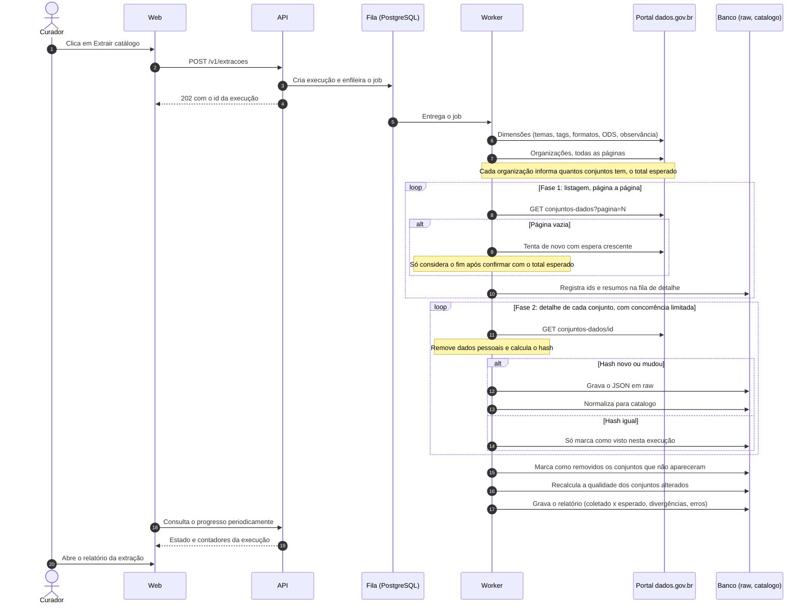
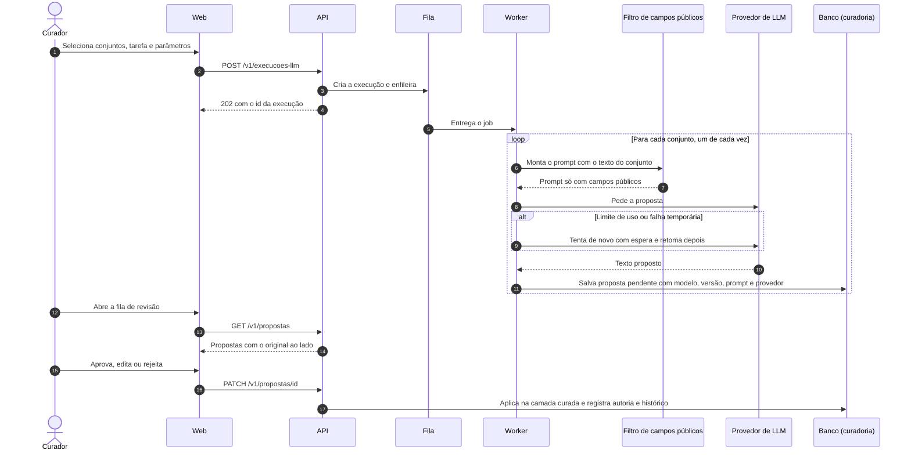
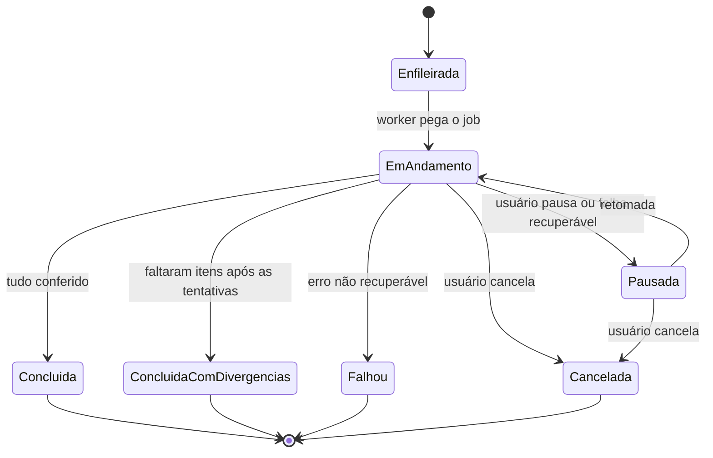
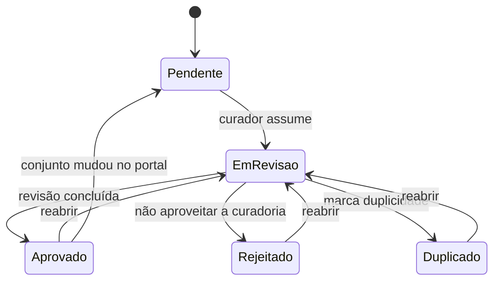
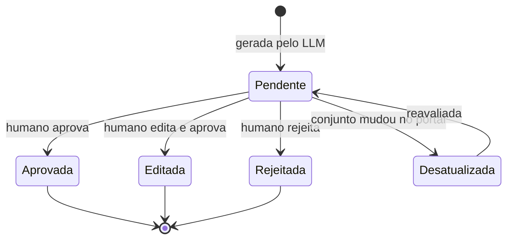

# C4 — Nível 4: Fluxos e estados

**Em palavras simples:** estes diagramas contam o que acontece, passo a passo, nas duas operações mais
importantes (trazer o catálogo do portal e curar com ajuda do LLM) e mostram por quais situações passam
as coisas que têm ciclo de vida (uma extração, um conjunto em curadoria, uma proposta do LLM). Não há
diagramas de classes, como combinado.

## 1. Extração do catálogo

A API do portal é intermitente: pode devolver lista vazia e logo depois devolver dados. Por isso uma
página vazia nunca encerra a coleta sozinha: o sistema tenta de novo e confere com o total que cada
organização declara ter.

**Pontos importantes**
- A execução pode ser **interrompida e retomada**: a fila de detalhe guarda o que falta.
- O hash é calculado **depois** de remover contatos pessoais (ver [modelo de dados](modelo-de-dados.md)).
- A chave da API só existe no ambiente do worker e nunca é registrada em log.

## 2. Curadoria assistida por LLM

Quem manda é o humano: escolhe os conjuntos, a tarefa e os parâmetros. O LLM só gera **propostas**.
Nada é aplicado sem aprovação.

**Pontos importantes**
- Cada proposta guarda **quem a gerou** (modelo, versão, provedor, "externo" ou "local"), o prompt e a
  decisão humana. Isso atende à supervisão humana e à auditabilidade exigidas pelo GuIA.
- Se o conjunto mudar no portal **depois** que a proposta foi gerada, a proposta fica **desatualizada**
  e não pode ser aprovada sem nova revisão (US-045).

## 3. Estados

### 3.1 Execução de extração

### 3.2 Status de curadoria de um conjunto

### 3.3 Proposta de LLM

