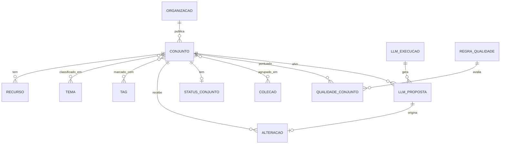

# Modelo de dados

**Em palavras simples:** os dados vivem em quatro "andares" dentro do mesmo banco
([ADR-0005](../03-decisoes/0005-armazenamento-em-camadas.md)). No primeiro fica a cópia fiel do que o
portal respondeu. No segundo, essa cópia organizada em tabelas. No terceiro, o que a curadoria decidiu.
No quarto, as contas prontas (qualidade, totais). O que veio do portal **nunca é alterado** pela curadoria:
a curadoria guarda só as diferenças.

Este é o desenho lógico. Nomes de colunas e tipos exatos saem na implementação, com migrações versionadas.

## 1. O que a API do portal realmente devolve (conferido em 2026-11-21)
- **Listagem:** `id`, `title`, `nome`, `nomeOrganizacao`, `catalogacao`, `ultimaAlteracaoMetadados`,
  `ultimaAtualizacaoDados`, `isAtualizado`. Só resumo.
- **Detalhe:** título, descrição, licença, periodicidade, temas, tags, cobertura temporal e espacial,
  versão, visibilidade, descontinuado, reuso, `recursos`, `conjuntoDadosAssociados`, datas, `atualizado`
  ("Atualizado"/"Desatualizado" calculado pelo portal), `selo` (ex.: Nenhum, Bronze), `dadosAbertos`,
  `observanciaLegal`, `origemCadastro`, e o responsável (nome e e-mail).
- **Cuidados:** alguns conjuntos aparecem na listagem mas o **detalhe devolve sempre HTTP 400** (1 em 60 na
  amostra); eles são gravados como `conjunto_sem_detalhe`, com o resumo da listagem e o motivo, e entram no
  relatório. Datas vêm como texto `dd/mm/aaaa`; várias propriedades vêm nulas (cobertura espacial,
  observância legal etc.); no detalhe a organização vem como *slug* (`nome`), enquanto a listagem traz o
  nome de exibição; o Swagger não lista `conjuntoDadosAssociados`.

## 2. Dados pessoais (ADR-0002, item 7)
Nome e/ou e-mail do responsável pelo conjunto vêm em muitos detalhes públicos (em uma amostra de 59,
nome em 30 e nome com e-mail em 16). Decisão de desenho:
- São **removidos na ingestão**, antes de gravar o bruto e antes de calcular o hash. Guarda-se apenas a
  informação de que existiam (`tem_responsavel`, `tem_email_responsavel`), útil para a regra de
  completude.
- Não entram em `catalogo`, nunca são devolvidos pela API e nunca vão a um LLM.
- **Contrapartida:** não será possível exibir nem exportar o contato. O DCAT-BR tem propriedade de
  contato; se o cliente quiser exportá-la, será decisão registrada em ADR (por exemplo, usar um
  contato institucional da organização em vez do pessoal).

## 3. Camadas e tabelas

### `raw` — documento bruto (só inserção)
| Tabela | Conteúdo |
|---|---|
| `execucao` | Cada extração: tipo (incremental ou completa), se foi forçada e quem pediu, início, fim, estado, parâmetros, totais. Um índice único parcial garante **uma execução ativa por vez** ([ADR-0006](../03-decisoes/0006-controle-de-extracoes.md)) |
| `documento` | `tipo` (conjunto, organização, tema, tag…), `chave_externa`, `hash`, `payload` (JSON), `execucao_id`, `coletado_em` |
| `visto` | Em quais execuções cada documento foi visto (permite detectar remoções) |

O payload só é gravado quando o hash muda. Os documentos já chegam sem dados pessoais.

### `catalogo` — espelho tabular (reconstruível a partir do `raw`)
| Tabela | Principais campos |
|---|---|
| `organizacao` | `id`, `slug`, `titulo`, `esfera`, `uf`, `municipio`, `qtd_conjuntos_declarada` |
| `conjunto` | `id`, `slug`, `titulo`, `descricao`, `organizacao_id`, `licenca`, `periodicidade`, `cobertura_temporal_inicio/fim`, `cobertura_espacial`, `granularidade_espacial`, `versao`, `descontinuado`, `dados_abertos`, `selo_portal`, `atualizado_portal`, `origem_cadastro`, datas (`catalogado_em`, `metadados_atualizados_em`, `dados_atualizados_em`), `removido_em`, `hash_atual` |
| `recurso` | `id`, `conjunto_id`, `titulo`, `descricao`, `formato`, `tipo`, `link`, `tamanho`, `downloads`, `ordem`, datas |
| `tema`, `tag`, `ods`, `observancia_legal` | Tabelas de domínio |
| `conjunto_tema`, `conjunto_tag`, `conjunto_ods` | Ligações muitos-para-muitos |
| `conjunto_associado` | Relação entre conjuntos (`conjuntoDadosAssociados`) |
| `conjunto_historico` | Mudanças por execução (novo, alterado, removido) |

Modelo alinhado ao DCAT-BR: `conjunto` ↔ `dcat:Dataset`, `recurso` ↔ `dcat:Distribution`,
`organizacao` ↔ publicador, `tema` ↔ `dcat:theme`, `tag` ↔ `dcat:keyword`. O mapeamento completo e a
exportação são do EP-11.

### `curadoria` — o que o projeto decidiu
| Tabela | Conteúdo |
|---|---|
| `alteracao` | Diferença sobre um campo de um conjunto: `campo`, `valor_curado`, `origem` (humano ou modelo), `proposta_id`, `autor`, `em`, `valor_original_no_momento` |
| `status_conjunto` | Estado atual de curadoria (pendente, em revisão, aprovado, rejeitado, duplicado) |
| `colecao` | Nome, descrição, responsável, tipo (manual ou dinâmica), `regra_filtro` (JSON) |
| `colecao_item` | Pertencimento, incluindo exceções manuais em coleções dinâmicas |
| `llm_tarefa` | Tarefa parametrizável com prompt versionado |
| `llm_execucao` | Lote: quem pediu, tarefa, parâmetros, provedor, modelo, "externo" ou "local" |
| `llm_proposta` | Proposta por conjunto: entrada, saída, estado, decisão humana, `desatualizada` |

### `analitico` — contas prontas (recalculáveis)
| Objeto | Conteúdo |
|---|---|
| `regra_qualidade` | Regras, dimensão (DQV/FAIR/DMBOK), peso, fonte e versão |
| `qualidade_conjunto` | Pontuação por regra e total, por execução (guarda histórico) |
| `conjunto_efetivo` (visão) | Espelho + alterações curadas aprovadas: a versão "a valer" de cada conjunto |
| `qualidade_organizacao`, `qualidade_tema` (visões materializadas) | Agregados |
| `busca_conjunto` (visão materializada) | Texto indexado do conjunto efetivo para busca em português |

## 4. Visão geral das relações

## 5. Regras de integridade
- **Identidade:** o `id` do portal é a chave natural do conjunto, do recurso e da organização.
- **Remoção lógica:** um conjunto que deixa de aparecer ganha `removido_em`; nunca é apagado.
- **Idempotência:** reprocessar o mesmo `raw` produz o mesmo `catalogo`.
- **Conflito:** se o portal mudar um campo que a curadoria também alterou, a alteração curada permanece,
  a proposta ligada a ele fica desatualizada e o conjunto volta a "pendente" para revisão humana.
- **Datas:** convertidas de `dd/mm/aaaa` para data; valores inválidos são registrados, não descartados.
